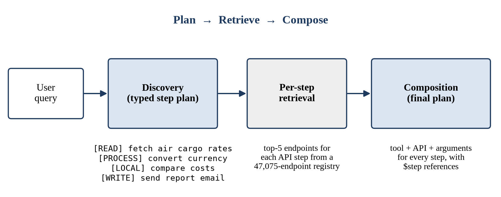
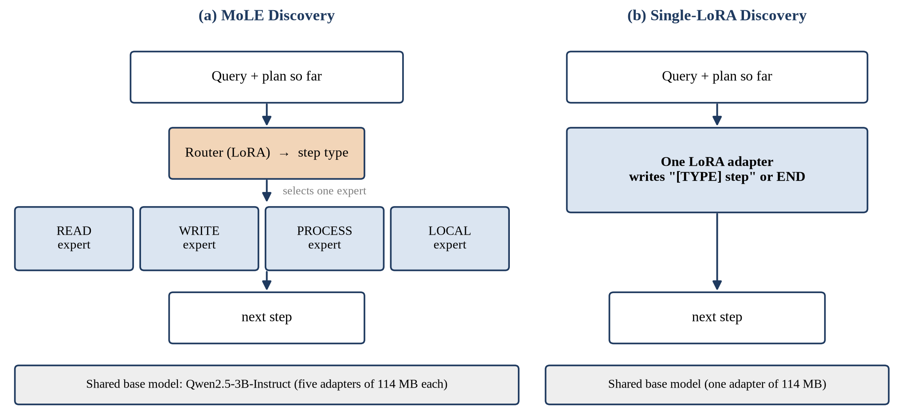
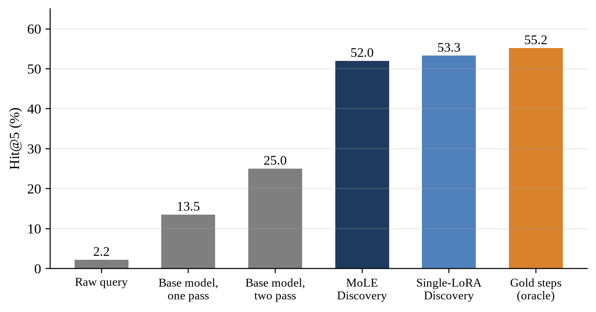
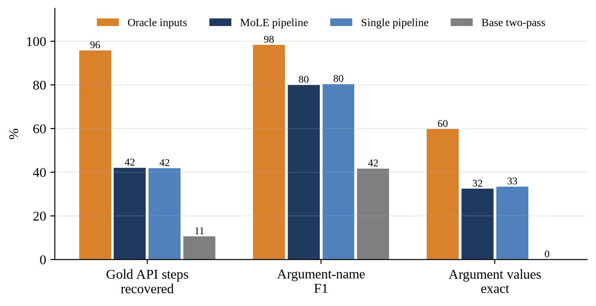
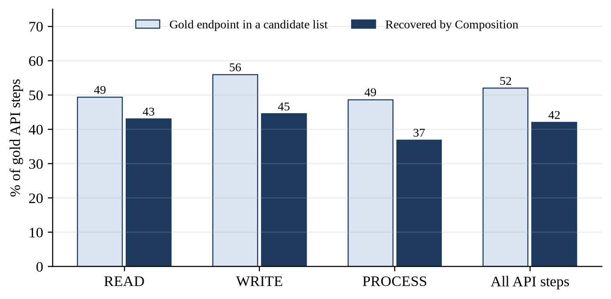
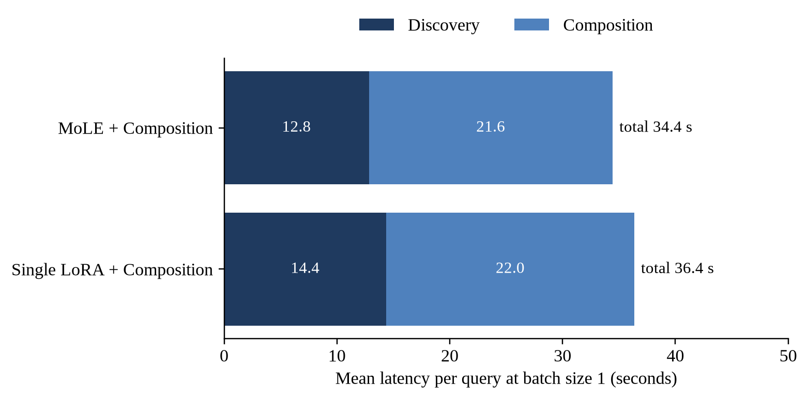

# RAG-MoLE: plan before you retrieve

How do you find the right APIs for a multi-step request in a registry of 47,075 endpoints? The request embeds as its dominant topic, so searching with it misses almost everything else the task needs. This project splits the problem into three passes:

1. **Discovery** writes a plan of typed steps: `READ`, `WRITE`, `PROCESS` (API calls) or `LOCAL`.
2. **Retrieval** searches the registry once per API step (all-MiniLM-L6-v2, top 5).
3. **Composition** picks one candidate per step and writes its arguments.



The hypothesis under test was that a **Mixture of LoRA Experts** for Discovery (a router plus one expert per step type) would beat a **single LoRA adapter**. In these experiments it did not.



## Setup

- Base model Qwen2.5-3B-Instruct, rank-16 LoRA, trained on one A10G (24 GB).
- 1,988 LLM-written, registry-grounded plans (1,600 train / 195 validation / 193 test). The registry is derived from ToolBench.
- All results below use the 193 test plans (1,008 gold API steps). Each gold step has a set of acceptable endpoints, because the registry holds many interchangeable APIs.

## Results

### Per-step search is what moves retrieval

| Query used for search | Hit@1 | Hit@5 | Hit@10 | MRR |
|---|---:|---:|---:|---:|
| Raw request | 1.1 | 2.2 | 3.1 | 0.021 |
| MoLE Discovery steps | 23.9 | 52.0 | 62.0 | 0.365 |
| Single-LoRA Discovery steps | 25.3 | 53.3 | 62.7 | 0.381 |
| Gold steps (oracle decomposition) | 26.1 | 55.2 | 64.9 | 0.390 |

A few-shot base model with no adapters reaches Hit@5 of 25.0 in two passes, and 13.5 when it writes the whole plan in one pass.



### The expert split does not pay for itself

| | MoLE | Single LoRA |
|---|---:|---:|
| Discovery Hit@5 (%) | 52.0 | 53.3 |
| API-step count exact (%) | 86.0 | 89.6 |
| End-to-end gold API steps recovered (%) | 42.1 | 41.9 |
| Discovery adapters on disk (MB) | 571.5 | 114.3 |
| Discovery training time (min) | 155.7 | 119.9 |
| Latency per query, batch 1 (s) | 34.4 | 36.4 |
| 193 queries, batch 16 (s) | 798 | 742 |

The mixture's one advantage is about 2 s lower latency at batch size 1 (30 queries, overlapping p95). The small accuracy lead of the single adapter comes from one seed with no significance test, so the supported reading is *no measurable benefit from the experts*, not *the single adapter is better*.

### Composition is limited by what retrieval hands it

| | Oracle inputs | MoLE pipeline | Single pipeline | Base, two-pass |
|---|---:|---:|---:|---:|
| Well-formed, executable plans (%) | 100.0 | 99.5 | 99.5 | 13.5 |
| Gold API steps recovered (%) | 95.8 | 42.1 | 41.9 | 10.6 |
| Argument-name F1, matched steps (%) | 98.4 | 80.0 | 80.4 | 41.7 |
| Exact argument values, matched steps (%) | 59.8 | 32.4 | 33.4 | 0.0 |

"Oracle inputs" means the gold plan, with the gold endpoint guaranteed to be among the five candidates. "Executable" is a static check (the output parses, candidates resolve, `$step` references point backwards). No API was called.



In the MoLE pipeline, **48.0%** of gold API steps never appear in any candidate list, **9.9%** appear but are not selected, and **42.1%** are recovered. The first group mixes Discovery errors with encoder ranking errors, which this analysis does not separate.



Asked to name endpoints directly, without retrieval, the base model gets the exact tool and API for 2.1% of gold steps, and 91.0% of the API names it writes do not exist in the registry.

### Latency

Composition, which is shared by both systems, accounts for most of the time. Retrieval takes about 10 ms.



## Limitations

- **In-distribution only.** Test queries come from the same LLM-authored process as the training data. Performance on real user requests is untested.
- **Gold bias.** Gold endpoints were chosen from intent-based candidate pools (BGE-M3 and TF-IDF), which favours intent-style search and likely understates the raw-query baseline.
- **Strict scoring.** A reasonable endpoint outside the acceptable set counts as a miss.
- **Statistical power.** One seed per system and no significance tests between the trained models.
- **No execution.** Plans are compared with gold plans, not judged by task success.
- **Untuned baseline.** The base model got one few-shot prompt design per stage.

An earlier pilot on 47 ToolBench queries was also negative: untrained zero-shot decomposition retrieved *worse* than the raw query (Hit@5 44.7 vs 55.3). Those queries differ from this project's dataset, so the two sets of numbers are not comparable ([pilot numbers](data/results/pilot/zero_shot_pilot_summary.json)).

## Code and reproduction

| Path | Contents |
|---|---|
| `src/` | Pipeline, training, evaluation, baselines and figures |
| `src/dataset/` | Plan generation, endpoint grounding, repair, review and train/validation/test splits |
| `scripts/` | GPU setup, file sync and end-to-end runs |
| `notebooks/` | API registry construction |
| `data/results/` | Per-run outputs and longer write-ups (start with [`ABLATION_RESULTS.md`](data/results/ABLATION_RESULTS.md)) |

```bash
pip install -r requirements.txt
bash scripts/run_mole.sh                 # train the router and experts, evaluate Discovery
bash scripts/run_ablation.sh             # train the single adapter and Composition, benchmark both pipelines
bash scripts/run_base.sh                 # base-model baselines
python3 src/error_breakdown.py           # where gold API steps are lost
python3 src/make_figures.py              # figures in docs/figures
```

The shell scripts expect a virtual environment at `venv/` in the repository root. The registry, the plan dataset and the adapter weights are **not included**, so a fresh clone cannot rerun training or scoring on its own (the training-loss figure also needs the local training logs). `notebooks/build_registry.ipynb` is the registry build step.
